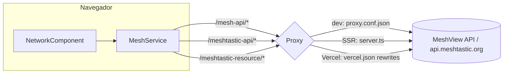

# Análisis del proyecto — Meshtastic México

> Fecha del análisis: 13 de octubre de 2026
> Alcance: código fuente en `src/`, configuración (`angular.json`, `vercel.json`, `proxy.conf.json`, `src/server.ts`), un build de producción y una revisión en navegador (escritorio 1280×800 y móvil 375×812) con datos reales de la API de MeshView.

---

## Índice

1. [Resumen ejecutivo](#1-resumen-ejecutivo)
2. [Descripción y stack](#2-descripción-y-stack)
3. [Arquitectura](#3-arquitectura)
4. [Métricas del build](#4-métricas-del-build)
5. [Errores confirmados](#5-errores-confirmados)
6. [Mejoras funcionales](#6-mejoras-funcionales)
7. [Mejoras visuales y de UX](#7-mejoras-visuales-y-de-ux)
8. [Accesibilidad](#8-accesibilidad)
9. [SEO y rendimiento](#9-seo-y-rendimiento)
10. [Calidad de código y mantenibilidad](#10-calidad-de-código-y-mantenibilidad)
11. [Contenido](#11-contenido)
12. [Hoja de ruta propuesta](#12-hoja-de-ruta-propuesta)
13. [Apéndice: código de ejemplo para las correcciones principales](#13-apéndice-código-de-ejemplo-para-las-correcciones-principales)

---

## 1. Resumen ejecutivo

Meshtastic México es el sitio de la comunidad mexicana de Meshtastic. Está hecho con Angular 19 (componentes standalone, SSR y prerender) y se despliega en Vercel. La página más valiosa es **`/network`**, que muestra nodos, mensajes y un mapa con datos en vivo de MeshView. El resto del sitio (inicio, acerca de, comunidad, proyectos y guías) es contenido estático escrito directamente en las plantillas.

**Lo que está bien**
- Todas las rutas usan lazy loading (`loadComponent`) y hay 11 rutas prerenderizadas. El bundle inicial pesa unos **105 kB transferidos**.
- Leaflet se importa de forma dinámica, sólo en el navegador, así que no infla el bundle inicial ni rompe el SSR.
- La identidad visual es clara (verde/blanco/rojo) y el diseño es responsive. En móvil no hay scroll horizontal.
- Las guías en español resuelven necesidades reales de quien empieza (915 MHz, MQTT `msh/MX`, apps).

**Problemas principales**

| # | Problema | Impacto |
|---|----------|---------|
| 1 | **XSS en los popups del mapa.** El nombre del nodo se inserta como HTML. Cualquier persona en la malla puede poner el nombre que quiera a su nodo. | Seguridad |
| 2 | **El mapa muestra como máximo 200 de los 1,163 nodos.** La API limita cada petición a 200 resultados, aunque se pidan 1000. | Funcional |
| 3 | **El ID del nodo aparece como `!!9ee6b708`** (doble `!`). | Visual |
| 4 | **Todos los nodos aparecen "en línea"** porque el valor está fijo en `true`. | Funcional |
| 5 | **Formularios que engañan.** En Proyectos, un error de envío se muestra como éxito. En Comunidad, el mensaje dice "te enviamos un correo", pero no se envía nada. | Confianza |
| 6 | **Cifras contradictorias entre páginas.** Por ejemplo, 50+, 291+ y 50+ "miembros/contribuidores", o 5, 16 y 8 ciudades/estados. Además hay 20 enlaces `href="#"`. | Credibilidad |
| 7 | **Accesibilidad.** El menú hamburguesa no se puede usar con teclado, los modales no tienen gestión de foco y la página declara `lang="en"`. | A11y |
| 8 | **Sin SEO por página.** Todas las páginas tienen el título `MeshtasticMx` y no hay meta description ni Open Graph. | Descubrimiento |

---

## 2. Descripción y stack

| Capa | Tecnología |
|------|------------|
| Framework | Angular 19.2 (standalone, `provideClientHydration(withEventReplay())`, `withFetch`) |
| Render | SSR con Express (`src/server.ts`) + prerender de rutas estáticas |
| Mapas | Leaflet 1.9.4 (import dinámico) + iframes de `meshmap.net` |
| Estilos | SCSS por componente, fuente Inter (Google Fonts), Font Awesome 6.0.0 (CDN) |
| Datos | API MeshView (`my.meshview.world/mexico/api`), API oficial Meshtastic (firmware y catálogo de hardware) |
| Formularios | Formspree (proyectos); el formulario de registro a eventos no está conectado a nada |
| Hosting | Vercel (`vercel.json` con rewrites que hacen de proxy) |
| Tests | Karma + Jasmine (sólo los specs generados por el CLI) |

---

## 3. Arquitectura

### 3.1 Estructura

```
src/
├── index.html                 ← lang="en", <title>MeshtasticMx</title>
├── styles.scss                ← variables globales, utilidades, @import de fuentes/iconos/leaflet
├── server.ts                  ← Express: 3 proxies + render SSR
└── app/
    ├── app.routes.ts          ← 6 rutas + 5 hijas en /guides, '**' → ''
    ├── components/            ← header, footer
    ├── models/mesh.model.ts   ← MeshNode, MeshPacket, TelemetryMetrics
    ├── services/mesh.service.ts
    ├── pipes/safe-url.pipe.ts ← no se usa en ningún componente
    └── pages/
        ├── home/  about/  community/  projects/
        ├── network/           ← única página con lógica de datos (414 líneas TS, 1,114 SCSS)
        └── guides/            ← contenedor + 5 guías hijas
```

### 3.2 Flujo de datos



> Hay **tres configuraciones de proxy** que deben mantenerse sincronizadas a mano (`proxy.conf.json`, `server.ts` y `vercel.json`). En Vercel el sitio se sirve estático, así que los proxies de `server.ts` no se usan en producción.

### 3.3 Rutas

| Ruta | Componente | Datos |
|------|------------|-------|
| `/` | Home | Estático + iframe meshmap.net |
| `/about` | About | Estático |
| `/community` | Community | Estático (eventos en un array dentro del TS) |
| `/network` | Network | **API en vivo**, refresco cada 60 s |
| `/projects` | Projects | Estático + formulario Formspree + iframe meshmap.net |
| `/guides/*` | Guides + 5 hijas | Estático |
| `**` | → `/` | No hay página 404 |

---

## 4. Métricas del build

`ng build` (producción) termina **sin errores**. El único aviso es que Leaflet es un módulo CommonJS.

| Métrica | Valor |
|---------|-------|
| Bundle inicial | 381.7 kB raw / **104.9 kB transferidos** |
| CSS global | 22.6 kB (incluye Leaflet **dos veces**, ver §9) |
| Chunk lazy más pesado | `leaflet-src` 149.5 kB (37.6 kB transferidos) |
| `network-component` | 55.8 kB (10.1 kB transferidos) |
| Rutas prerenderizadas | 11 |
| SCSS más grande | `network.component.scss`, 29.9 kB de código fuente |

Datos de la API observados durante la revisión:
- `total` de nodos: **1,163**. `limit` máximo efectivo por petición: **200**.
- De 200 nodos, 153 tienen posición.
- `firmware` llega como `null` en los 200 nodos.
- En la telemetría, `battery_level` vale **101** con frecuencia (alimentación externa).

---

## 5. Errores confirmados

Ordenados por severidad. Cada uno se verificó en el código y, cuando se pudo, en el navegador con datos reales.

### 5.1 🔴 XSS en los popups del mapa
**Dónde:** [network.component.ts:351-362](src/app/pages/network/network.component.ts:351)

```ts
.bindPopup(`... <strong>${node.long_name || node.id}</strong> ... <p>${node.hw_model}</p> ...`)
```
`bindPopup` con un string inserta el contenido como HTML. `long_name` lo elige libremente el dueño de cada nodo y llega por MQTT. Un nodo llamado `` ejecutaría JavaScript en el navegador de cualquier visitante que abra su popup.
**Solución:** construir el popup con nodos DOM y `textContent`, o escapar el HTML (ver [apéndice 13.1](#131-popup-del-mapa-sin-xss)).

### 5.2 🔴 El mapa sólo muestra una fracción de la red
**Dónde:** [mesh.service.ts:65-68](src/app/services/mesh.service.ts:65)

`getAllNodes()` pide `limit=1000`, pero la API responde con `limit: 200` y `has_next: true` (`total: 1163`). En la práctica, el mapa muestra unos 150 de más de 1,100 nodos.
**Solución:** recorrer las páginas mientras `has_next` sea `true` (ver [apéndice 13.2](#132-obtener-todos-los-nodos-paginando)) y agrupar los marcadores con `leaflet.markercluster`.

### 5.3 🟠 Doble `!` en el ID del nodo
**Dónde:** [network.component.html:79](src/app/pages/network/network.component.html:79) y [network.component.html:176](src/app/pages/network/network.component.html:176)

La API ya devuelve `id: "!e5c89138"` y la plantilla le antepone otro `!`. En pantalla se ve `!!9ee6b708`.
**Solución:** quitar el `!` literal de la plantilla.

### 5.4 🟠 Todos los nodos aparecen "en línea"
**Dónde:** [network.component.html:70](src/app/pages/network/network.component.html:70) — `[class.online]="true"`

**Solución:** calcular el estado a partir de `last_seen_us`. Por ejemplo, en línea si se vio hace menos de 2 h, inactivo si fue hace menos de 24 h, y desconectado si fue hace más.

### 5.5 🟠 Batería "101%"
**Dónde:** [network.component.html:186-201](src/app/pages/network/network.component.html:186)

En Meshtastic, `battery_level = 101` significa que el nodo tiene alimentación externa. Hoy se muestra "101%" y la barra pasa del 100%.
**Solución:** si el valor es mayor que 100, mostrar "🔌 Alimentación externa" y limitar la barra al 100%.

### 5.6 🟠 Error de envío mostrado como éxito
**Dónde:** [projects.component.ts:55-61](src/app/pages/projects/projects.component.ts:55)

En el bloque `error` del envío a Formspree se marca `isSubmitted = true` y se borra el formulario. Si el envío falla, la persona cree que se envió y pierde lo que escribió.
**Solución:** mostrar un error y conservar los datos del formulario.

### 5.7 🟠 El formulario de registro a eventos no se puede abrir y promete algo falso
**Dónde:** [community.component.ts:112](src/app/pages/community/community.component.ts:112), [community.component.html:273](src/app/pages/community/community.component.html:273)

- `showRegistration()` no se llama desde ninguna plantilla, así que el formulario nunca se muestra.
- `onSubmit()` sólo hace `console.log`, pero el mensaje de éxito dice "Te hemos enviado un correo de confirmación".
- Los `console.log` de depuración siguen en el código de producción.

**Solución:** conectarlo a Formspree (como en Proyectos) o a un enlace de Luma/Google Forms, o bien eliminar el código muerto.

### 5.8 🟡 "Próximos eventos" muestra un evento pasado
**Dónde:** [community.component.ts:85-95](src/app/pages/community/community.component.ts:85)

El único evento es del 17 de febrero de 2026 y aparece bajo el título "Próximos Eventos". El horario "5:00 PM - 7:00 PM" está escrito a mano en la plantilla ([community.component.html:142](src/app/pages/community/community.component.html:142)) en lugar de calcularse desde `date`/`endDate`.
**Solución:** separar los eventos en "Próximos" y "Pasados" comparando con la fecha actual, y mostrar un estado vacío del tipo "¿Quieres organizar uno?".

### 5.9 🟡 Los filtros de proyectos no hacen nada
**Dónde:** [projects.component.html:77-81](src/app/pages/projects/projects.component.html:77)

Los botones tienen `data-filter`, pero ninguna lógica los usa.

### 5.10 🟡 La suscripción a eventos del router nunca se cancela
**Dónde:** [guides.component.ts:204](src/app/pages/guides/guides.component.ts:204)

`this.router.events.subscribe(...)` no se cancela. Cada vez que se entra a `/guides` se agrega otra suscripción que sigue haciendo scroll aunque se haya salido de la sección.
**Solución:** `takeUntilDestroyed()`.

### 5.11 🟡 El refresco automático borra la vista cada minuto
**Dónde:** [network.component.ts:57-87](src/app/pages/network/network.component.ts:57)

Cada 60 s se pone `loadingNodes = true`, lo que reemplaza toda la cuadrícula por un spinner, hace perder la posición de lectura y vuelve a lanzar las animaciones de entrada. Además, el refresco sigue corriendo aunque la pestaña esté oculta y también vuelve a pedir el firmware.
**Solución:** refrescar en segundo plano (sin spinner si ya hay datos), pausar con `document.visibilityState` y pedir el firmware una sola vez.

### 5.12 🟡 Otros errores menores
- **La búsqueda sólo filtra la página actual** (50 nodos), lo que da a entender que el nodo no existe ([network.component.ts:116](src/app/pages/network/network.component.ts:116)).
- **El aviso "Actualización disponible" nunca aparece**, porque `firmware` siempre llega `null`. Además, la comparación `latestFirmware.indexOf(firmware)` no es una comparación de versiones válida.
- **Condición de carrera en el detalle del nodo:** si se cierra un nodo y se abre otro rápido, la telemetría del primero puede llegar después y mostrarse en el segundo (falta `switchMap` o cancelar la petición).
- **`window.scrollTo({ top: 400 })` está fijo** ([network.component.ts:113](src/app/pages/network/network.component.ts:113)).
- **Dos `<h1>` en `/network`** ("Estado de la Red" y "Nodos Activos").
- **Los specs de `AppComponent` fallarían.** Esperan `title === 'meshtastic-mx'` y un `h1` con "Hello, meshtastic-mx" ([app.component.spec.ts:17-27](src/app/app.component.spec.ts:17)).
- **El © 2025 está fijo** en el footer ([footer.component.html:51](src/app/components/footer/footer.component.html:51)).

---

## 6. Mejoras funcionales

### 6.1 Página de Red (`/network`), el núcleo del sitio

| Propuesta | Detalle |
|-----------|---------|
| **Mapa completo con clústeres** | Paginar la API (§5.2) y usar `leaflet.markercluster`. Colorear los marcadores según el rol (ROUTER, CLIENT, TRACKER, SENSOR…) y según el tiempo desde la última vez que se vio cada nodo. |
| **Panel de estadísticas en vivo** | Tarjetas con el total de nodos, nodos activos en las últimas 24 h, routers, gateways MQTT y mensajes de hoy. Todo sale de la API que ya se consume, y estos datos **reemplazarían las cifras escritas a mano** de Home, Comunidad y Proyectos. |
| **Búsqueda del lado del servidor** | Si MeshView lo permite, enviar el término a la API. Si no, buscar sobre el conjunto completo ya paginado. |
| **Filtros** | Por rol, por modelo de hardware, por "con ubicación" y por "activo en las últimas X h". Combinarlos con `?rol=ROUTER&q=...` en la URL para poder compartir la vista. |
| **URL por nodo** | Crear la ruta `/network/node/:id` en lugar de un modal. Así se puede compartir el enlace a un nodo, el botón "Atrás" funciona y hay mejor SEO. |
| **Gráficas de telemetría** | Hoy se muestran los primeros 100 caracteres del payload en crudo. Conviene parsear batería, voltaje, `channel_utilization` y `air_util_tx` y dibujar sparklines de las últimas 24-48 h. |
| **Estado vacío y de error** | Si la API falla, hoy sólo se ve un spinner que se apaga y luego nada. Hace falta un mensaje con un botón "Reintentar". |
| **Ranking de hardware** | Un gráfico de barras con los modelos más usados en México. También sirve para la guía "Comprar nodo". |
| **Mensajes** | Agrupar por canal, resaltar menciones y enlazar el remitente con su nodo. |

### 6.2 Comunidad
- Mover los eventos a un archivo `src/assets/data/events.json` (o a una colección en GitHub) para que la comunidad pueda proponer eventos con un PR.
- Permitir descargar los eventos como `.ics`, además de Google Calendar.
- En "Grupos locales", cambiar los `href="#"` por enlaces reales a Telegram de cada grupo, o retirar el botón.
- Agregar un **mapa de grupos locales** que reutilice Leaflet.

### 6.3 Proyectos
- Mover los proyectos a `projects.json` con `slug`, `categoria`, `estado`, `enlaces` e `imagen`.
- Implementar los filtros por categoría y estado con un `signal`.
- Crear una página de detalle `/projects/:slug`. Hoy todos los "Ver detalles" llevan a `#`.
- Formulario: mostrar el error real, agregar un campo honeypot anti-spam y mandar una copia de confirmación a quien envía.

### 6.4 Guías
- **Navegación entre guías** con botones "← Anterior / Siguiente →" y un indicador de progreso (1/5).
- **Estado inicial de `/guides`**: hoy, debajo del `<hr>`, no se muestra nada. Conviene redirigir a la primera guía o mostrar un texto de bienvenida.
- **Guías nuevas sugeridas**: "Canales y cifrado (PSK)", "Roles de nodo: ¿cuándo usar ROUTER?", "Antenas y línea de vista", "Nodo solar", "Regulación en México (IFT, banda ISM 902-928 MHz)" y "Solución de problemas".
- Un botón "Copiar configuración" en la guía MQTT (`msh/MX`, etc.).
- Un buscador simple de guías o una sección de FAQ.

### 6.5 Transversales
- **Página 404** propia en lugar de redirigir a Home.
- **PWA / modo offline** con `@angular/pwa`. Encaja con el tema: las guías deberían poder consultarse sin conexión, que es justo cuando alguien necesita Meshtastic.
- **Cambio de tema claro/oscuro** (§7.3).
- **Analítica respetuosa con la privacidad** (Plausible, Umami o Vercel Analytics) para saber qué guías se leen.

---

## 7. Mejoras visuales y de UX

### 7.1 Problemas observados en el navegador

| Observación | Dónde | Propuesta |
|-------------|-------|-----------|
| **"México" del logo casi invisible** sobre el hero: texto verde sobre fondo verde. | Header sin scroll, en Home | Usar texto blanco en el header transparente y sólo pasar a los colores de la bandera cuando el header tenga fondo blanco (`.scrolled`). |
| **Degradado verde→rojo con el centro "café"**. El texto blanco sobre la zona intermedia pierde contraste. | Heroes de todas las páginas | Usar un fondo sólido verde oscuro (`#004d35`) con un acento rojo (franja, borde o elemento gráfico), o un degradado verde→verde oscuro con detalles en rojo. |
| **Botón "Comienza Aquí" con degradado verde→rojo** y texto blanco: el contraste cambia a lo largo del botón. | Hero de Home | Usar un solo color sólido. Es la acción más importante, así que debe ser **la primera y la más destacada**. |
| **Tres CTA apilados en móvil** que compiten entre sí. | Hero de Home | Dejar una acción primaria ("Comienza aquí") y una secundaria ("Únete a la comunidad"). |
| **El visual del hero es un placeholder** (5 puntos y líneas en CSS) y ocupa media pantalla en móvil. | Home | Mostrar un mini-mapa real de nodos o un SVG animado de la malla sobre la silueta de México. En móvil, reducirlo u ocultarlo. |
| **El menú no cabe en ~800 px de ancho** (se corta "Acerca de"). | Header, tablet | Bajar el breakpoint del menú hamburguesa a ~960 px o quitar los iconos del menú en anchos intermedios. |

### 7.2 Sistema de diseño
Ahora mismo cada componente redefine sus propias piezas:

- `.container` está definido **16 veces**, `.hero` **5 veces**, `.btn` **4 veces**, y `.glass-card` y `.guide-btn` **5 veces** cada uno (uno por guía).
- Hay más de 25 colores hex distintos. Conviven **dos verdes de marca** (`#006847` y `#006341`, este último en la bandera SVG) con los verdes de Material (`#2e7d32`, `#388e3c`, `#1b5e20`), y **varios rojos** (`#CE1126`, `#c62828`, `#d32f2f`).
- `network.component.scss` declara sus propias variables (`--text-muted`, `--border-color`…) que no existen a nivel global.

**Propuesta:**
1. Crear `src/styles/_tokens.scss` con una paleta cerrada: `--color-primary`, `--color-primary-strong`, `--color-accent`, `--surface`, `--surface-raised`, `--text`, `--text-muted`, `--border`, una escala de espaciado (4/8/12/16/24/32/48), radios y sombras.
2. Crear `src/styles/_components.scss` con `.container`, `.btn` (`--primary`, `--secondary`, `--ghost`), `.card`, `.badge` y `.page-hero`, y quitar las copias de cada componente.
3. Componentes reutilizables: `<app-page-hero title subtitle>`, `<app-stat-card>`, `<app-guide-layout>` (que reemplazaría las 5 copias de estilos de las guías) y `<app-modal>`.
4. Una sola bandera SVG como componente `<app-mx-flag>` (hoy está duplicada en el header y el footer, con colores distintos).

### 7.3 Modo oscuro
El sitio no tiene modo oscuro (no hay ningún `prefers-color-scheme`). La página de Red, con su mapa, se presta mucho a uno.
- Definir los tokens de color en `:root` y redefinirlos en `@media (prefers-color-scheme: dark)` y en `[data-theme="dark"]`.
- Agregar un interruptor en el header y guardar la preferencia en `localStorage`.
- Mapa: usar tiles oscuros (CARTO Dark Matter) cuando el tema esté en oscuro.

### 7.4 Iconografía y tipografía
- **Mezcla de emojis y Font Awesome** como iconos (📡🔋🌐🔒 junto a `fa-*`). Los emojis se ven distintos en cada sistema operativo. Conviene usar un solo set, por ejemplo Font Awesome o Lucide en SVG inline.
- **Font Awesome 6.0.0 completo** (más de 70 kB de CSS y fuentes) se carga para unos 40 iconos. Conviene pasar a SVG por icono con `@fortawesome/angular-fontawesome` y tree-shaking, o usar Lucide.
- Tipografía: definir una escala fija (por ejemplo 14/16/18/20/24/32/40/56) y usar `clamp()` en los títulos del hero.

### 7.5 Microinteracciones
- **Quitar `* { transition: all 0.3s ease; }`** ([styles.scss:79-81](src/styles.scss:79)). Anima *cualquier* cambio de *cualquier* propiedad en *todos* los elementos: cuesta rendimiento, provoca efectos raros al redimensionar y probablemente interfiere con las capas de Leaflet (posible causa de los "tiles grises" que hoy se intentan arreglar con tres `invalidateSize()` seguidos). Mejor declarar transiciones específicas en hover y focus.
- Respetar `prefers-reduced-motion`: desactivar `animate-bounce`, `pulse` y las animaciones escalonadas de las tarjetas.
- Usar skeleton loaders en lugar de spinners en `/network` (la forma de la tarjeta, con shimmer).
- Indicar "Actualizado hace X s" con un punto verde pulsante en lugar de sólo la hora.

### 7.6 Imágenes
- La guía "Comprar nodo" enlaza **directamente imágenes `.avif` de AliExpress**. Si el producto cambia o AliExpress bloquea el hotlinking, las imágenes se rompen. Conviene descargarlas, optimizarlas y servirlas desde `public/images/hardware/`, o reutilizar las del flasher oficial que ya usa `MeshService`.
- Usar `NgOptimizedImage` (`ngSrc`, `width`/`height`) para evitar saltos de layout (CLS). Hoy 13 `` no tienen `loading` ni dimensiones.

---

## 8. Accesibilidad

| Problema | Dónde | Corrección |
|----------|-------|------------|
| **El botón del menú móvil es un `<div>`**: no se puede enfocar ni usar con teclado y no tiene nombre accesible. | [header.component.html:43](src/app/components/header/header.component.html:43) | Cambiarlo por `<button type="button" aria-label="Abrir menú" [attr.aria-expanded]="isMobileMenuOpen" aria-controls="main-nav">`. |
| **Enlaces sociales del menú móvil sin texto** (sólo icono). | [header.component.html:34-37](src/app/components/header/header.component.html:34) | Agregar `aria-label="GitHub"` y `aria-label="Telegram"`. |
| **Modales sin `role="dialog"`, sin `aria-modal`, sin cerrar con Esc y sin atrapar el foco.** | Red y Comunidad | Usar `<dialog>` nativo, o `@angular/cdk/dialog`, que lo resuelve. |
| **Tarjetas de nodo y de evento como `<div (click)>`.** | [network.component.html:67](src/app/pages/network/network.component.html:67), comunidad | Usar `<button>` o `<a>`, o como mínimo `tabindex="0"`, `role="button"` y `(keydown.enter)`. |
| **`lang="en"`** en un sitio en español: los lectores de pantalla lo pronuncian en inglés. | [index.html:2](src/index.html:2) | Cambiar a `lang="es-MX"`. |
| **Contraste insuficiente** (logo, degradados, texto `#666` sobre fondos claros tintados). | Varios | Verificar con un comprobador WCAG AA (4.5:1 para texto normal). |
| **Emojis decorativos que se leen en voz alta.** | Guías, Home | Agregar `aria-hidden="true"`. |
| **Sin "Saltar al contenido".** | App | Agregar `<a class="skip-link" href="#main">` como primer elemento enfocable. |
| **Enlaces externos** (`target="_blank"`) sin aviso: 38 de ellos tampoco tienen `rel="noopener"`. | Varios | Agregar `rel="noopener noreferrer"` y un icono o texto que indique que se abre en otra pestaña. |
| **`:focus` en lugar de `:focus-visible`.** | [styles.scss](src/styles.scss) | Usar `:focus-visible` para que el anillo de foco no aparezca al hacer clic con el ratón. |

---

## 9. SEO y rendimiento

### SEO
- **Mismo título en todas las páginas** (`MeshtasticMx`). Angular ya trae la propiedad `title` en las rutas: `{ path: 'network', title: 'Red en vivo · Meshtastic México', ... }`.
- **Sin `<meta name="description">` ni Open Graph/Twitter Cards.** Al compartir en Telegram o WhatsApp no aparece una vista previa decente. Conviene un `SeoService` que use `Meta` por ruta y una imagen OG de 1200×630.
- **Sin `sitemap.xml` ni `robots.txt`** en `public/`.
- **Contenido duplicado:** "¿Qué es Meshtastic?" aparece en Home, About y en la guía `/guides/que-es-meshtastic`. Conviene dejar un solo texto completo y que las otras páginas resuman y enlacen.
- Datos estructurados `Organization` y `Event` (JSON-LD) para que los eventos aparezcan en Google.

### Rendimiento
- **CSS de Leaflet incluido dos veces**: en `angular.json → styles` y con `@import` en [styles.scss:4](src/styles.scss:4). Basta con quitar una de las dos.
- **Leaflet CSS en el bundle global**: se carga en todas las páginas aunque sólo lo usa `/network`. Conviene cargarlo de forma lazy o en los estilos del componente con `ViewEncapsulation.None`.
- **`@import url(...)` de Google Fonts y Font Awesome dentro del CSS**: forma una cadena de peticiones que bloquea el render. Es mejor usar `<link rel="preconnect">` + `<link rel="stylesheet">` en `index.html`, o autoalojar Inter.
- **Dos iframes de `meshmap.net`** (Home y Proyectos) cargan un sitio completo de terceros. Se pueden reemplazar por el mapa propio con Leaflet, que ya existe, o como mínimo mostrar una imagen estática con "Cargar mapa interactivo" (facade).
- **Métodos llamados desde la plantilla** (`getNodeImage()`, `getTimeAgo()`, `filteredNodes` como getter) se ejecutan en cada ciclo de detección de cambios, varias veces por tarjeta. Conviene precalcularlos al recibir los datos o usar `computed()`.
- **Sin caché en los proxies** de `server.ts` y `vercel.json`. Conviene agregar `Cache-Control: s-maxage=30, stale-while-revalidate=60` a las respuestas de MeshView para descargar la API y acelerar la carga.
- **`MeshService` pide el catálogo de hardware en el constructor**, también durante el SSR o prerender. Conviene pedirlo bajo demanda, sólo en el navegador, y guardarlo en caché (`shareReplay`).

---

## 10. Calidad de código y mantenibilidad

| Área | Estado actual | Recomendación |
|------|---------------|---------------|
| **Versión de Angular** | 19.2 | Actualizar a la versión vigente con `ng update`. |
| **Control flow** | `*ngIf` / `*ngFor` + `CommonModule` | Migrar a `@if` / `@for` (`ng g @angular/core:control-flow`). `@for` exige `track`, lo que mejora el rendimiento de las listas. |
| **Estado** | Propiedades mutables + getters | Usar **signals** (`signal`, `computed`) y, para las peticiones, `rxResource`/`toSignal`. Ayuda a preparar el paso a una app zoneless. |
| **Inyección** | Constructor con `@Inject(PLATFORM_ID)` | `inject()` y `afterNextRender()` para el código que sólo corre en el navegador. |
| **Tipado** | `any` en el mapa, `deviceHardware: any[]`, `response: any` | Tipar `DeviceHardware`, `FirmwareList`, y usar `import type * as L from 'leaflet'`. |
| **Separación de responsabilidades** | `NetworkComponent` hace de todo: datos, mapa, parseo de telemetría y modal | Separar en `NodeListComponent`, `MessageListComponent`, `NetworkMapComponent`, `NodeDetailComponent` y un `TelemetryParser` en un servicio o función pura testeable. |
| **Parseo de payloads** | Regex sobre texto protobuf (`text:\s*"([^"]*)"`) | Se rompe con comillas escapadas, `\n` y escapes octales de UTF-8. Si MeshView ofrece JSON decodificado, usarlo. Si no, escribir un parser con tests. |
| **Contenido** | Escrito en las plantillas | Mover eventos, proyectos, grupos y hardware a archivos `*.json` tipados en `src/assets/data/` (o a Markdown con frontmatter). Así la comunidad puede contribuir sin tocar Angular. |
| **Código muerto** | `SafeUrlPipe` sin uso, `showRegistration()` sin uso, canales comentados en Comunidad, comentarios de plantilla en `server.ts` | Eliminarlo. |
| **Tests** | Sólo los specs generados (y el de `AppComponent` está roto); `network` no tiene spec | Pruebas unitarias para `MeshService` (paginación y parseo), `getTimeAgo` y el parser de telemetría. Un e2e con Playwright para "abrir /network → ver nodos → abrir detalle". |
| **Calidad** | Sin linter ni formateador | `ng add @angular-eslint/schematics`, Prettier y un hook de pre-commit (husky + lint-staged). |
| **CI** | No hay | GitHub Actions con `npm ci`, `ng lint`, `ng test --watch=false` y `ng build`. |
| **Proxies duplicados** | 3 lugares | Centralizar las URLs en `environment.ts` y documentar en el README que hay que mantener sincronizado `vercel.json`. |
| **README** | Es el que genera el CLI | Reescribirlo: qué es el proyecto, cómo levantarlo, de dónde vienen los datos, cómo contribuir con contenido y cómo se despliega. |

---

## 11. Contenido

- **Cifras inconsistentes** (todas escritas a mano):

  | Página | Miembros | Proyectos | Ciudades/Estados | Nodos |
  |--------|----------|-----------|------------------|-------|
  | Home | 50+ | 10+ | 5 ciudades | — |
  | Comunidad | 291+ | 25+ | 16 ciudades | — |
  | Proyectos | 50+ contribuidores | 25+ | 8 estados | 150+ |
  | Proyecto "Red Mesh CDMX" | — | — | — | "11 nodos", "6 en CDMX", "19 nacionales" |
  | **API (real)** | — | — | — | **1,163** |

  Conviene obtener las cifras de la API o de un único `stats.json`.
- **Proyectos que parecen de ejemplo** (AgroMesh, VineMesh, EduMesh, RescueMesh…), todos con enlaces `#`. Si no existen, es mejor quitarlos y mostrar "Sé el primero en registrar tu proyecto". Si existen, enlazarlos.
- **20 enlaces `href="#"`** (grupos locales, recursos, proyectos). Si un enlace no lleva a nada, es mejor retirarlo.
- **Errores en la guía "Comprar nodo"** ([comprar-nodo.component.html](src/app/pages/guides/comprar-nodo/comprar-nodo.component.html)):
  - "28db" debería ser "28 dBm" (potencia, no ganancia).
  - El `alt` de la imagen del Heltec **v4** dice "Heltec v3", y el del **T114** dice "Heltec H114".
  - "Kit Meshtástico" debería ser "Kit Meshtastic".
  - La nota sobre antenas pide conector **IPEX**, pero las antenas listadas son **SMA**. Hay que explicar cuándo hace falta cada uno o el adaptador.
  - El enlace "Comprar en Mercadolibre - Heltec v2" está dentro de la tarjeta del v3.
- **Acentos que faltan:** "Guia Rapida" → "Guía rápida", "Ubicacion" → "Ubicación", "Generica" → "Genérica", "mas moderna" → "más moderna".
- **Regulación:** conviene añadir una nota sobre el uso de la banda ISM 902-928 MHz en México y los límites de potencia, para dar más confianza a quien empieza.

---

## 12. Hoja de ruta propuesta

### Fase 1 — Correcciones rápidas (1-2 días)
- [ ] Corregir el XSS del popup del mapa (§5.1)
- [ ] Quitar el doble `!` del ID (§5.3)
- [ ] Calcular el estado en línea desde `last_seen_us` (§5.4)
- [ ] Manejar la batería = 101 (§5.5)
- [ ] Mostrar el error real en el formulario de Proyectos (§5.6)
- [ ] Separar eventos próximos y pasados; quitar el texto de "correo enviado" (§5.7, §5.8)
- [ ] Cambiar a `lang="es-MX"`, poner `title` en cada ruta y agregar meta description (§8, §9)
- [ ] Convertir el menú hamburguesa en `<button>` con `aria-*` (§8)
- [ ] Quitar el `* { transition: all }` global y la doble carga del CSS de Leaflet (§7.5, §9)
- [ ] Corregir la ortografía y los datos de la guía de hardware (§11)
- [ ] Cancelar la suscripción en `GuidesComponent` (§5.10)

### Fase 2 — Red en vivo de verdad (1 semana)
- [ ] Paginación completa de nodos y clústeres en el mapa (§5.2)
- [ ] Panel de estadísticas en vivo, que también alimente Home, Comunidad y Proyectos (§6.1)
- [ ] Filtros por rol y por actividad, guardados en la URL
- [ ] Ruta `/network/node/:id` y sparklines de telemetría
- [ ] Refresco en segundo plano sin spinner, que se pause con la pestaña oculta (§5.11)
- [ ] Reemplazar los iframes de meshmap.net por el mapa propio

### Fase 3 — Sistema de diseño y modo oscuro (1 semana)
- [ ] Tokens globales y componentes compartidos (§7.2)
- [ ] Nuevo hero sin degradado verde-rojo, logo con buen contraste y CTA único (§7.1)
- [ ] Modo oscuro con interruptor (§7.3)
- [ ] Un solo set de iconos en SVG (§7.4)
- [ ] Modales accesibles (CDK Dialog) y `prefers-reduced-motion`

### Fase 4 — Contenido y comunidad (continuo)
- [ ] Mover eventos, proyectos, grupos y hardware a JSON y documentar en el README cómo contribuir
- [ ] Filtros y página de detalle de proyectos
- [ ] Guías nuevas, navegación anterior/siguiente y FAQ
- [ ] PWA con guías disponibles sin conexión
- [ ] Página 404, sitemap y Open Graph

### Fase 5 — Mantenimiento técnico (en paralelo)
- [ ] Actualizar Angular, migrar a control flow y signals
- [ ] ESLint, Prettier y GitHub Actions
- [ ] Tests de `MeshService`, del parser y e2e de `/network`

---

## 13. Apéndice: código de ejemplo para las correcciones principales

### 13.1 Popup del mapa sin XSS

```ts
// network.component.ts — reemplaza el template string de bindPopup
private buildPopup(node: MeshNode): HTMLElement {
  const root = document.createElement('div');
  root.className = 'map-popup';

  const header = root.appendChild(document.createElement('div'));
  header.className = 'popup-header';
  header.appendChild(document.createElement('strong')).textContent = node.long_name || node.id;
  const role = header.appendChild(document.createElement('span'));
  role.className = 'popup-role';
  role.textContent = node.role ?? '';

  const body = root.appendChild(document.createElement('div'));
  body.className = 'popup-body';
  body.appendChild(document.createElement('p')).textContent = node.hw_model;
  body.appendChild(document.createElement('small')).textContent = `Visto: ${this.getTimeAgo(node.last_seen_us)}`;

  const btn = root.appendChild(document.createElement('button'));
  btn.className = 'btn-popup-details';
  btn.type = 'button';
  btn.textContent = 'Ver detalles completos';
  btn.addEventListener('click', () => this.viewNodeDetails(node));

  return root;
}

// uso:
L.circleMarker([...]).bindPopup(this.buildPopup(node), { closeButton: false, className: 'custom-popup' })
```

### 13.2 Obtener todos los nodos paginando

```ts
// mesh.service.ts
import { EMPTY, expand, reduce } from 'rxjs';

getAllNodes(pageSize = 200): Observable<MeshNode[]> {
  const fetchPage = (page: number) =>
    this.http.get<NodesResponse>(`${this.baseUrl}/nodes`, { params: { limit: pageSize, page } });

  return fetchPage(1).pipe(
    expand(res => (res.has_next ? fetchPage(res.page + 1) : EMPTY)),
    reduce((all, res) => all.concat(res.nodes), [] as MeshNode[]),
  );
}
```

### 13.3 Estado en línea y batería

```ts
// utilidades puras, fáciles de testear
export type NodeStatus = 'online' | 'idle' | 'offline';

export function nodeStatus(lastSeenUs: number, now = Date.now()): NodeStatus {
  const minutes = (now - lastSeenUs / 1000) / 60_000;
  if (minutes < 120) return 'online';
  if (minutes < 24 * 60) return 'idle';
  return 'offline';
}

export function batteryLabel(level?: number): string {
  if (level == null) return '—';
  return level > 100 ? 'Alimentación externa' : `${level}%`;
}
```

```html
<!-- network.component.html -->
<div class="node-status" [attr.data-status]="nodeStatus(node.last_seen_us)"></div>
...
<span class="node-id">{{ node.id }}</span>   <!-- sin el "!" extra -->
```

### 13.4 Título y descripción por ruta

```ts
// app.routes.ts
{ path: 'network', title: 'Red en vivo · Meshtastic México', loadComponent: ... },
{ path: 'guides',  title: 'Guías · Meshtastic México', loadComponent: ... },
```

```ts
// seo.service.ts — escucha NavigationEnd y aplica route.data['description']
this.meta.updateTag({ name: 'description', content: description });
this.meta.updateTag({ property: 'og:title', content: title });
```

### 13.5 Menú hamburguesa accesible

```html
<button type="button" class="mobile-menu-toggle"
        [class.active]="isMobileMenuOpen"
        [attr.aria-expanded]="isMobileMenuOpen"
        aria-controls="main-nav"
        [attr.aria-label]="isMobileMenuOpen ? 'Cerrar menú' : 'Abrir menú'"
        (click)="toggleMobileMenu()">
  <span></span><span></span><span></span>
</button>
<nav id="main-nav" class="nav" [class.mobile-open]="isMobileMenuOpen"> ... </nav>
```

### 13.6 Refresco sin parpadeo

```ts
// Sólo muestra el spinner en la primera carga; pausa con la pestaña oculta.
this.refreshSubscription = interval(60_000).pipe(
  filter(() => document.visibilityState === 'visible'),
).subscribe(() => this.fetchNodes({ silent: true }));

fetchNodes({ silent = false } = {}) {
  if (!silent || this.nodes.length === 0) this.loadingNodes = true;
  ...
}
```
